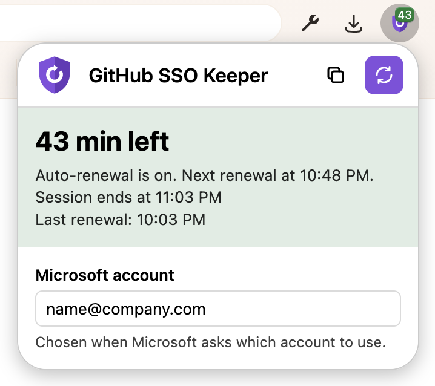

# GitHub SSO Keeper

A browser extension for Firefox and Chrome that keeps your GitHub Enterprise Cloud SSO session alive, built for Microsoft Entra ID OIDC single sign-on.
It renews the session in the background and clicks SSO prompts for you, so frequent re-authentication stops interrupting your work.

## Features

- Renews the session in a background tab 5 minutes before it ends, while you are active on GitHub.
- Continues the full-page SSO prompt and GitHub's in-page "session expired" modal.
- Picks your account on Microsoft's "Pick an account" page.
- Shows the minutes left on the toolbar icon: green when healthy, blue while renewing, yellow when paused or failed, red when expired.

## Install

1. Add the extension from your browser's store:
   - [Firefox](https://addons.mozilla.org/en-US/firefox/addon/github-sso-keeper/), version 140 or newer
   - [Chrome](https://chromewebstore.google.com/detail/github-sso-keeper/dfjekelphnagkdgkcoijjchfheafjofj), version 148 or newer
2. Pin *GitHub SSO Keeper* in the browser's extensions menu to keep the minutes left on the toolbar icon in view.
3. Click the toolbar icon and enter your Microsoft sign-in name, for example `name@company.com`, in the *Microsoft account* field.
   If several accounts are signed in, Microsoft waits for you to pick one.
   Without the name, a renewal fails within seconds and the popup states the reason.
4. Open or reload a page of your GitHub organization while signed in through SSO.
   The icon then shows the minutes left, and the popup reads "Auto-renewal is on".
5. Click *Renew now* in the popup to check the setup.
   The icon turns blue while renewing, and the popup lists the time of the last renewal once it succeeds.

## Limits

Renewal needs an open GitHub tab and pauses after 45 minutes without activity.
The next GitHub page then shows the SSO prompt once, which the extension continues.
