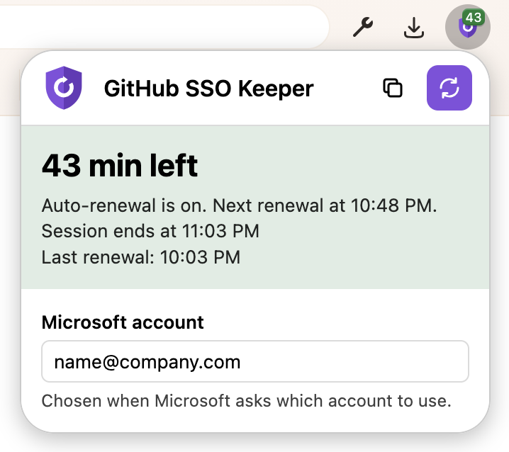

# GitHub SSO Keeper

A browser extension for Firefox, Chrome and Edge that keeps your GitHub Enterprise Cloud SSO session alive, built for Microsoft Entra ID OIDC single sign-on.
It renews the session in the background and clicks SSO prompts for you, so frequent re-authentication stops interrupting your work.

## Features

- Renews the session in a background tab 5 minutes before it ends, while you are active on GitHub.
- Continues the full-page SSO prompt and GitHub's in-page "session expired" modal.
- Picks your account on Microsoft's "Pick an account" page.
- Shows the minutes left on the toolbar icon: green when healthy, blue while renewing, yellow when paused or failed, red when expired.

## Requirements

- Firefox 140 or newer
- Chrome 148 or newer
- Edge 148 or newer

## Choose the Microsoft account

If several accounts are signed in, Microsoft waits for you to pick one.
Enter your sign-in name, for example `name@company.com`, in the *Microsoft account* field of the popup.
Without it, a renewal fails within seconds and the popup states the reason.

## Limits

Renewal needs an open GitHub tab and pauses after 45 minutes without activity.
The next GitHub page then shows the SSO prompt once, which the extension continues.
